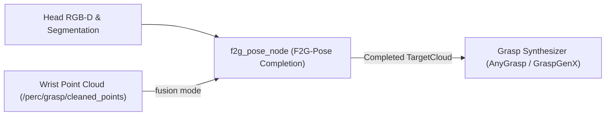

# f2g_pose_ros2

[](https://docs.ros.org/en/humble/) [](LICENSE) [](mailto:teamrobontu@gmail.com)

> **Companion Packages:** Requires `core_r1_interfaces` from `public-core-grasp`. Python dependencies: [`requirements.txt`](requirements.txt).

ROS 2 Humble wrapper for **F2G-Pose** providing single-view 3D shape completion, 6-DoF pose estimation, and visibility-aware head-to-wrist ICP point cloud fusion.

Designed to work both standalone (`direct_head` mode) and integrated inside [`Team-Robo/public-core-grasp`](https://github.com/Team-Robo/public-core-grasp) (`fusion` mode).


## Architecture



## Features

- **Single-View 3D Shape Completion (`direct_head` mode):** Reconstructs a complete 3D point cloud of a segmented target object from a single head-camera RGB-D view.
- **Head-to-Wrist ICP Fusion (`fusion` mode):** Aligns and fuses the F2G-Pose completed head-camera shape with the live wrist-camera point cloud (`/perc/grasp/cleaned_points`) to handle occlusion and partial views during grasping.
- **Portable Path Resolution:** Automatically discovers `third_party/F2G-Pose` and Conda environments (`CONDA_PREFIX`, `F2G_CONDA_SITE`, `~/miniconda3/envs/grasp`, or `F2G_POSE_ROOT`) without hardcoded paths.

## Prerequisites & Installation

- **OS / ROS:** Ubuntu 22.04, ROS 2 Humble
- **Workspace Dependencies:** `core_r1_interfaces` (from [`public-core-grasp/src/core-r1_interface`](https://github.com/Team-Robo/public-core-grasp))
- **Python / GPU Environment:** PyTorch + CUDA environment (e.g., the `grasp` Conda environment from `public-core-grasp/environment.yml`)

Clone with submodules into your ROS 2 workspace `src/`:

```bash
cd ~/ros2_ws/src
git clone --recurse-submodules https://github.com/Team-Robo/public-manip-f2g_pose_ros2.git manip-f2g_pose_ros2
cd ~/ros2_ws
colcon build --symlink-install --packages-select f2g_pose_ros2
source install/setup.bash
```

## Model Weights Placement

Place the pretrained F2G-Pose and RADIO weights under `third_party/F2G-Pose/weights/` (or pass custom paths via ROS parameters):

- `third_party/F2G-Pose/weights/f2g-pose.pt`
- `third_party/F2G-Pose/weights/radio-v2.5-l_half.pth.tar`
- `third_party/F2G-Pose/configs/sope.yaml`
- `third_party/F2G-Pose/third_party_local/RADIO`

You can override the F2G-Pose root or Conda site-packages directory via environment variables if needed:

```bash
export F2G_POSE_ROOT=/path/to/F2G-Pose
export F2G_CONDA_SITE=/path/to/conda/envs/grasp/lib/python3.10/site-packages
```

## Usage

### 1. Standalone (`direct_head` mode)

Runs F2G-Pose directly on head-camera RGB-D and segmentation mask inputs:

```bash
ros2 launch f2g_pose_ros2 f2g_pose.launch.py \
  f2g_mode:=direct_head \
  target_label:=cup \
  head_color_topic:=/camera/head_d455/color/image_raw \
  head_depth_topic:=/camera/head_d455/depth/image_rect_raw \
  head_mask_topic:=/perc/head/mask
```

### 2. Integrated (`fusion` mode — `core-grasp` default)

Fuses head-camera F2G-Pose shape completion with wrist-camera point clouds:

```bash
ros2 launch f2g_pose_ros2 f2g_pose.launch.py \
  f2g_mode:=fusion \
  target_label:=cup \
  wrist_cloud_topic:=/perc/grasp/cleaned_points
```

Or launch via the full `public-core-grasp` perception pipeline (`grasp_bringup/launch/r1_head_perception.launch.py`).

### Key Parameters (`config/f2g_pose.yaml`)

| Parameter | Default | Description |
|---|---|---|
| `f2g_mode` | `"fusion"` | `"fusion"` (head+wrist ICP fusion) or `"direct_head"` (standalone head completion) |
| `target_label` | `""` | Target object label (e.g. `"cup"`, `"bottle"`) |
| `checkpoint` | `""` | Path to `f2g-pose.pt` (auto-resolves to `third_party/F2G-Pose/weights/f2g-pose.pt` when empty) |
| `config_path` | `""` | Path to `sope.yaml` (auto-resolves when empty) |
| `radio_repo` | `""` | Path to `RADIO` repo (auto-resolves when empty) |
| `radio_checkpoint` | `""` | Path to RADIO checkpoint (auto-resolves when empty) |
| `device` | `"cuda:0"` | PyTorch compute device |
| `base_frame` | `"base_link"` | Target TF frame for output point clouds and poses |

## Testing

```bash
pytest test/
```

## References

- [F2G-Pose](https://github.com/jrryzh/F2G-Pose) — original upstream repository ([Project Page](https://jrryzh.github.io/F2G-Pose/), [Weights](https://huggingface.co/J3rr1/F2G-Pose))
- *F2G-Pose: Geometry-Aware Foundation Feature Lifting for Direct RGB-D Category-Level Object Pose Estimation* ([arXiv:2610.31623](https://arxiv.org/abs/2610.31623))
- [Open3D](https://github.com/isl-org/Open3D) — point cloud processing and ICP registration

## Contributors

- **Tan Jin Hern** (`@jinhern424`)
- **Tang Pei Wen** (`@peiwen10`)
- **Hu Ming Jie** (`@humjie`)

Maintained by **Nanyang Technological University Team Robo** (`teamrobontu@gmail.com`).

## License

This ROS 2 wrapper is licensed under the Apache License 2.0 — see the [LICENSE](LICENSE) file for details. Upstream `third_party/F2G-Pose` retains its own license.
